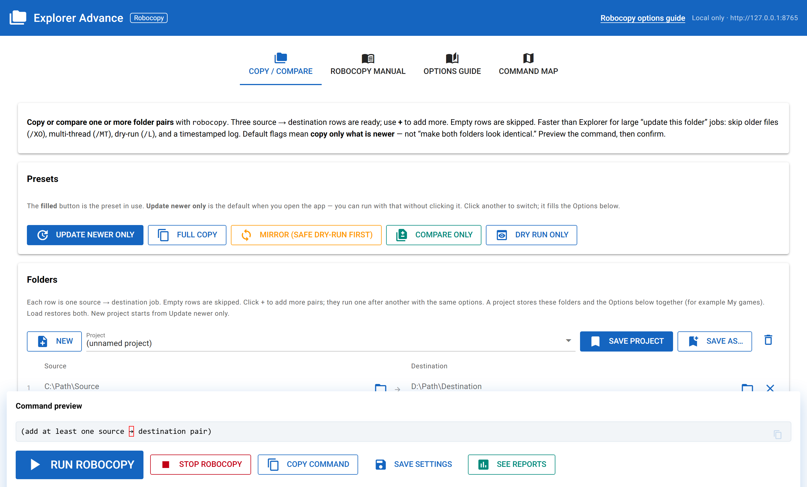

# Explorer Advance — Robocopy

A **NiceGUI** desktop UI for Windows **`robocopy.exe`**.

`robocopy` is the built-in command for bulk folder copy and sync. This app is the Robocopy sibling of **[Explorer Advance — Cipher](https://github.com/vnvlthm/Advanced-Cipher)**.

Fill source → destination rows, preview the exact command, confirm, and run. Jobs run one after another. Live output, timestamped logs, and **See reports**.

## Features

| Tab | What it does |
|---|---|
| **Copy / Compare** | Folder pairs (3 rows by default, **+** to add more), named **projects** (folders + options), presets, extra flags (`/PURGE`, `/XJD`, …), filters (`/XD`, `/XF`, `/MAXAGE`, `/COPYALL`), command preview, confirm, live terminal, See reports. |
| **Robocopy manual** | What Robocopy is, quick start, projects, Purge vs Mirror, More flags, Filters, safety. |
| **Options guide** | Companion HTML tour of interesting flags. Also at `/docs/robocopy-options.html`. |
| **Command map** | Every interesting switch with syntax, examples, and **In this app** vs **UI later**. |

Default preset is **Update newer only** (`/E /XO /FFT`). **Compare only** lists differences with no copy. **`/MIR`** and **`/PURGE`** can delete destination extras and need extra confirmation.

## Screenshot



Source → destination pairs, presets, command preview, then confirm.

## Requirements

- Windows (Robocopy is included)
- Python 3.10+
- NiceGUI

## Install

```powershell
py -3 -m pip install -r requirements.txt
```

## Run

From this folder:

```powershell
py -3 main.py
```

The UI listens on **http://127.0.0.1:8765** only (not on the LAN). Settings are saved locally to `user_config.json`, which is gitignored. Logs go under `logs/` (also gitignored).

If port 8765 is taken, the app picks the next free port and prints it. Or:

```powershell
py -3 main.py --port 9876
```

## Usage — Copy / Compare

1. Fill one or more **source → destination** rows. Empty rows are skipped.
2. Optionally **Save as…** a named project (for example **My games**). That stores the folders **and** the Options. **New** starts a blank project on Update newer only.
3. Pick a **preset**. Options apply to every filled pair.
4. Optionally enable **Dry run** first, or **Compare only**.
5. Check the **command preview**, then **Run Robocopy** (or **Compare folders**). Confirm the argv.
6. Watch the Output terminal. Pairs run one after another. Each job writes its own timestamped log.
7. Open **See reports** for this session’s logs (one report per folder row). Older logs stay on disk in the log folder.

### Compare only (no copy)

Compare lists differences only (new, newer, older, modified, extras on dest). Logs are named `compare_YYYYMMDD_HHMMSS.log`.

### “Another Robocopy is already running”

A leftover `robocopy.exe` from an older run can keep going after the window looks idle. Use **Stop Robocopy**, or:

```powershell
taskkill /IM robocopy.exe /F
```

## Exit codes

Robocopy treats several non-zero codes as success:

| Code | Meaning |
|-----:|---------|
| 0 | Nothing copied (already up to date) |
| 1 | Files copied successfully |
| 2–7 | Completed with extras/mismatches (usually OK) |
| ≥ 8 | Failure |

**Exit code 1 after a real update is normal.**

## Safety

- Preview the exact command before any write.
- **`/MIR`** and **`/PURGE`** can delete files on the destination. Extra acknowledgement is required.
- A **drive root** as source or destination also needs extra acknowledgement on a real copy.
- `/MOVE` is documented on the Command map and is **not wired**.
- See [SECURITY.md](SECURITY.md) for localhost binding and reporting.

## Project layout

```
main.py                   # NiceGUI app
robocopy_ops.py           # subprocess, Win32, log parsing
robocopy_docs.py          # Manual text + command catalog
requirements.txt
user_config.example.json  # shape of the local settings file
docs/robocopy-options.html
docs/screenshots/         # UI capture for this README
```

## License

[MIT](LICENSE) — CedricVV
